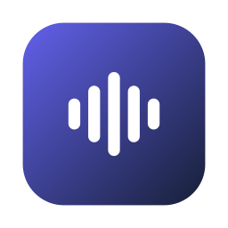

<p align="center">
  
</p>

<h1 align="center">Diktat für Windows</h1>

<p align="center">
  <b>Speak. Text. Done.</b><br>
  Dictation for Windows that runs on your PC.
</p>

<p align="center">
  
  <a href="LICENSE"></a>
  <a href="https://github.com/MProductionsGmbH/diktat-app-win/actions/workflows/ci.yml"></a>
</p>

<p align="center">
  <a href="https://github.com/MProductionsGmbH/diktat-app-win/releases/latest/download/Diktat-Setup.exe"><b>Download Diktat for Windows</b></a>
  &nbsp;·&nbsp;
  <a href="#build-it-yourself">Build it yourself</a>
  &nbsp;·&nbsp;
  <a href="https://github.com/MProductionsGmbH/diktat-app">Diktat for Mac</a>
</p>

Hold a shortcut, speak, let go. Diktat turns your speech into text and pastes it where your cursor is. Speech recognition runs on your PC. No account, no Diktat server, no audio leaving the device.

This is the Windows version of [Diktat for Mac](https://github.com/MProductionsGmbH/diktat-app). The text logic, prompts and settings are ported one to one from the Mac app; a settings export from the Mac (custom terms, replacements, modes) can be imported.

## Install

1. **[Download Diktat-Setup.exe](https://github.com/MProductionsGmbH/diktat-app-win/releases/latest/download/Diktat-Setup.exe)** and run it. It installs for your user only, no admin rights needed.
2. Windows SmartScreen may warn because the app is not signed yet: click **More info**, then **Run anyway**.
3. Diktat sits in the system tray (bottom right, next to the clock). The setup assistant asks for the microphone and loads a speech model once.

Without an installer: download `Diktat-win-x64.zip` (or `Diktat-win-arm64.zip` for Snapdragon PCs) from the [releases](https://github.com/MProductionsGmbH/diktat-app-win/releases), unpack it anywhere and start `Diktat.exe`.

## How It Works

1. **Hold** `Ctrl + Win`.
2. **Speak** in any language your model knows. A small lilac pill at the bottom of the screen shows that Diktat is listening.
3. **Let go.** Diktat transcribes on your PC with Parakeet or Whisper.
4. **Done.** The text appears at your cursor, fitted to the text around it. Your clipboard is restored afterwards.

## Modes

| Mode | Shortcut (hold) | What happens |
|---|---|---|
| **Diktat** | `Ctrl + Win` | Speech to text; the cleanup level (light, medium, strong, AI written style) and the tone are set in the app |
| **Diktat WTF** | `Ctrl + Win + Alt` | Frustrated speech to a calm, effective message |
| **Diktat :-)** | `Ctrl + Win + Shift` | Text with fitting emojis |

Every shortcut can be changed in the settings, also to "press once to start, again to stop".

## Features

- **Local speech recognition:** Parakeet TDT 0.6B v3 (fast, 25 European languages) via sherpa-onnx, or OpenAI Whisper via whisper.cpp (about 100 languages). Both detect the spoken language.
- **Writing modes with your own model:** KI-Schreibstil, WTF and :-) use a model provider with your own API key (OpenAI, Anthropic, Google Gemini, Mistral, OpenRouter) or a local server on your PC such as Ollama or LM Studio, so it can run offline. Diktat finds Ollama and LM Studio by itself.
- **Smooths what you stumble over:** *Leicht* removes "ähm", stutters and phrases said twice without any model. *Mittel* also drops restarts and self-corrections, *Stark* also fixes grammar, word order and punctuation.
- **Fits where you type:** spaces and capitals follow the text around your cursor (read through Windows UI Automation). Password fields are never read.
- **Mode per app or website:** Outlook always in AI written style, Slack with emojis, everything else word for word.
- **Text lands in the right place:** if you click into another window while a writing mode still works, the text goes to the clipboard instead of the wrong field.
- **Sound off while recording:** music or a podcast is muted while you speak and back right after.
- **Meetings:** record a conversation through the microphone, or an online meeting (Teams, Zoom, Meet) with the sound your PC plays. You get the transcript by person and, with a model server on this PC, a summary with decisions and to-dos. Meetings never go to an internet provider. Please ask everyone before you record.
- **Voice memos and WhatsApp voice messages:** drop an audio file on Diktat and get the text.
- **Dictionary:** names and terms spelled your way, fixed replacements ("n acht n" becomes "n8n").
- **History:** recent results, encrypted for your Windows user (DPAPI) and stored only on your PC.
- **Updates:** Diktat tells you when a new version is on GitHub (can be turned off).

The app is in German for now.

## Privacy

```text
Speech recognition:  your PC (Parakeet via sherpa-onnx or Whisper via whisper.cpp)
Writing modes:       your own model provider with your own API key,
                     or a local server on your PC (Ollama, LM Studio)
Meetings:            your PC; summaries only with a model server on this PC
API keys, history:   encrypted for your Windows user (DPAPI)
Model download:      Hugging Face / GitHub, once per model
Update check:        GitHub releases of this repository (can be turned off)
```

Diktat has no backend and collects no data.

## Requirements

- Windows 10 (version 2004 or newer) or Windows 11, x64 or ARM64.
- About 1 GB of disk space for the Parakeet model, 1.6 GB for Whisper Large v3 Turbo.
- 8 GB of memory recommended.

## Build It Yourself

You need the [.NET 10 SDK](https://dotnet.microsoft.com/download/dotnet/10.0).

```powershell
git clone https://github.com/MProductionsGmbH/diktat-app-win.git
cd diktat-app-win
dotnet test Diktat.slnx
dotnet run --project src/Diktat.Windows
```

A self-contained single file:

```powershell
dotnet publish src/Diktat.Windows -c Release -r win-x64 --self-contained -p:PublishSingleFile=true -p:IncludeNativeLibrariesForSelfExtract=true -o publish
```

The platform-neutral projects (`Diktat.Core`, `Diktat.AI`, `Diktat.Transcription`) build and test on macOS and Linux too; the Windows app compiles there with `EnableWindowsTargeting`, but runs only on Windows.

### Project layout

| Project | What it holds |
|---|---|
| `src/Diktat.Core` | Settings, text cleanup (filler words, replacements, custom terms, e-mail addresses, paragraphs, fitting), history |
| `src/Diktat.AI` | Prompts, model providers, rewrites, meeting summaries, update check |
| `src/Diktat.Transcription` | Parakeet and Whisper, model downloads, audio decoding, speaker diarization |
| `src/Diktat.Windows` | The WPF app: tray, windows, hotkeys, microphone, paste, UI Automation |
| `tests/*` | xUnit tests, many ported from the Mac app |

### Releasing

Push a tag `vX.Y.Z`. The release workflow tests, publishes x64 and ARM64 builds, builds the installer with Inno Setup and attaches everything to a GitHub release.

## Known Limitations

- **Not signed yet:** SmartScreen warns on first start.
- **Apps running as administrator:** Windows does not let a normal app paste into them. Start Diktat as administrator too, or paste with `Ctrl + V` yourself (the text is on the clipboard).
- **Whisper on silence** sometimes invents phrases like "Untertitel im Auftrag des ZDF". Diktat filters the known ones.
- **Online meetings:** without headphones the microphone also hears the speakers. Diktat filters that echo out of your part; a short scrap can remain.

## License

MIT, see [LICENSE](LICENSE). Third-party components are listed in [THIRD_PARTY_NOTICES.md](THIRD_PARTY_NOTICES.md).
